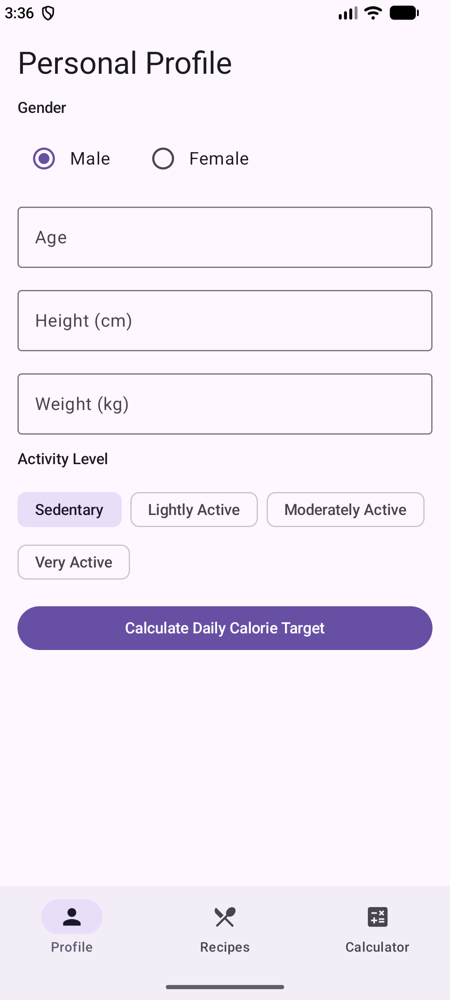

# SmartCooking · 智能烹饪与卡路里管理

SmartCooking 是一个**本地优先**的 Android 健康饮食应用：根据你的身体数据计算 BMI、基础代谢（BMR）、每日总消耗（TDEE）与每日热量目标，并据此推荐菜谱；同时提供菜谱搜索、营养详情和自定义餐食热量计算。

**技术栈**：Kotlin · Jetpack Compose · Material 3 · Hilt · Room · DataStore · Retrofit / OkHttp

<p align="center">
  
  
</p>

## 目录

- [功能一览](#功能一览)
- [使用指南](#使用指南)
- [构建与运行](#构建与运行)
- [项目结构](#项目结构)
- [当前推荐逻辑](#当前推荐逻辑)
- [后续：接入大模型 API](#后续接入大模型-api)
- [已知限制](#已知限制)

---

## 功能一览

| 模块 | 说明 |
|---|---|
| 个人档案 | 性别、年龄、身高、体重、活动水平，计算 BMI / BMR / TDEE / 每日热量目标与三大营养素配比 |
| 个性化推荐 | 根据档案的单餐热量预算推荐 2 道菜；保存新档案后自动重算；下拉刷新重新随机 |
| 一日三餐计划 | 按每日目标的 30% / 40% / 30% 生成早餐、午餐、晚餐组合（每餐 1-3 样）；支持换一换 |
| 菜谱库 | 14 道内置菜谱，支持按**菜名或食材名**搜索，按难度、烹饪时长筛选 |
| 菜谱详情 | 封面、时长 / 难度 / 热量、食材用量与吸油系数、分步做法、每项食材热量 |
| 热量计算器 | 自由组合食材、重量、烹饪方式与额外用油，计算整餐总热量与蛋白质 / 碳水 / 脂肪 |
| 离线可用 | 首次启动自动写入 Room 种子数据，档案保存在 DataStore，无需联网即可使用全部功能 |

> 界面文案当前为英文（Profile / Recipes / Calculator 三个底部标签），菜谱内容为中文。

---

## 使用指南

### 1. 启动应用

启动页展示约 1.8 秒后自动进入主界面，默认停留在 **Profile（个人档案）** 标签页。底部导航包含三个入口：

- **Profile**：填写身体数据、计算并保存热量目标
- **Recipes**：浏览推荐与全部菜谱
- **Calculator**：自定义餐食热量计算

### 2. 填写个人档案（Profile）

1. 选择 **Gender**：Male / Female。
2. 输入 **Age**（岁）、**Height (cm)**、**Weight (kg)**。
3. 选择 **Activity Level** 活动水平：
   - Sedentary（久坐，系数 1.2）
   - Lightly Active（轻度活动，1.375）
   - Moderately Active（中度活动，1.55）
   - Very Active（高强度活动，1.725）
4. 点击 **Calculate Daily Calorie Target**。
5. 页面顶部会显示能量卡片与详细结果：
   - **BMI 与体型分类**：`Underweight · weight gain`（BMI < 18.5）、`Normal · maintain`（18.5–23.9）、`Overweight · fat loss`（≥ 24）
   - **Target**：每日目标热量（kcal）
   - **BMR**：基础代谢率
   - **TDEE**：每日总消耗
   - **Macronutrients**：碳水 / 蛋白质 / 脂肪比例及克数，附饮食建议
6. 点击 **Save Profile** 保存。保存成功后底部弹出 `Profile saved` 提示。

> **推荐功能依赖已保存的档案。** 如果不点 Save Profile，Recipes 页不会出现“Recommended for you”推荐区。档案会持久化，下次启动自动回填。

计算规则：

- BMR 使用 Mifflin-St Jeor 公式（男性 / 女性分别计算）
- TDEE = BMR × 活动系数
- 目标热量：BMI ≥ 24 时取 TDEE × 0.8；BMI < 18.5 时取 TDEE × 1.15；正常范围取 TDEE
- 营养素比例：减脂 40/30/30、增重 55/25/20、维持 50/20/30（碳水 / 蛋白质 / 脂肪）

### 3. 查看一日三餐计划（Plan）

1. 先在 **Profile** 页填写并保存档案。
2. 切换到 **Plan** 标签：
   - 顶部显示每日目标热量、计划合计与蛋白质 / 碳水 / 脂肪合计。
   - 下方依次是 **Breakfast / Lunch / Dinner**，每餐列出 1-3 样具体食物及该餐目标 / 实际热量。
3. 点击 **Regenerate** 或在页面顶部下拉，可重新随机一份计划。
4. 点击任意食物卡片进入菜谱详情。
5. 修改并保存档案后，Plan 会自动按新目标重算；计划不跨 App 重启保存，重启后会重新生成。

> 热量分配：早餐 30%、午餐 40%、晚餐 30%。计划只以热量为约束，蛋白质 / 碳水 / 脂肪合计仅作展示。

### 4. 浏览与筛选菜谱（Recipes）

- 顶部 **Recommended for you** 区域：若已保存档案，显示 2 道按单餐预算挑选的推荐菜谱，并标注 `Recommended` 徽章。
- **搜索框**：输入菜名或食材名（如“鸡胸肉”“番茄”）即可模糊搜索。
- **难度筛选**：All / Easy / Medium / Hard（数据库中难度仍以中文存储，仅展示时映射为英文）。
- **时长筛选**：Any duration / ≤15 min / ≤30 min / ≤60 min / ≤2 h。
- **下拉刷新**：在列表顶部下拉，会重新加载列表并**重新随机推荐**两道菜。
- 点击任意菜谱卡片进入详情页。

### 5. 查看菜谱详情

详情页依次展示：

1. 封面图与返回按钮
2. 菜名、烹饪时长、难度、总热量
3. 菜谱简介
4. **Total calories** 能量卡片：总热量及蛋白质 / 碳水 / 脂肪
5. **Ingredients**：每种食材的用量、烹饪方式、额外用油与对应热量
6. **Cooking steps**：带编号的分步做法

### 6. 计算自定义餐食热量（Calculator）

1. 每个食材卡片中选择 **Select ingredient**（共 18 种内置食材）。
2. 输入 **Weight (g)** 重量。
3. 选择 **Cooking method**（水煮、清蒸、凉拌、煎、炒、炖、烤、炸）。
4. 输入 **Added oil (g)** 额外用油量（没有可填 0）。
5. 点击 **+ Add ingredient** 可添加多行；点击 **Remove** 删除当前行（至少保留一行）。
6. 点击 **Calculate Calories**，查看总热量与蛋白质 / 碳水 / 脂肪。

计算方式：食材自身热量按 `每 100g 热量 × 重量 / 100` 计算；额外用油按 `油量 × 9 kcal/g × 该烹饪方式的吸油系数` 计入总热量与脂肪。

### 7. 数据说明

- 菜谱、食材、烹饪方式在首次启动时写入本地 Room 数据库（18 种食材、9 种烹饪方式、14 道菜谱），之后完全离线可用。
- 个人档案保存在 DataStore，重启应用后仍然有效。
- 当前没有账号体系，数据仅存于本机；卸载应用会清空数据。

---

## 构建与运行

### 环境要求

- Android Studio（支持 `compileSdk 37`）
- JDK 11+
- Android SDK Platform 37
- 最低运行版本：Android 8.0（API 26）

### 步骤

1. 克隆仓库：

   ```bash
   git clone https://github.com/cyrus-leung666/SmartCooking.git
   cd SmartCooking
   ```

2. 在项目根目录创建 `local.properties`，指向本机 Android SDK：

   ```properties
   sdk.dir=/path/to/Android/Sdk
   ```

   Windows 示例：`sdk.dir=C\:\\Users\\<you>\\AppData\\Local\\Android\\Sdk`

3. 构建 Debug APK：

   ```bash
   # macOS / Linux
   ./gradlew assembleDebug

   # Windows
   gradlew.bat assembleDebug
   ```

4. 产物路径：`app/build/outputs/apk/debug/app-debug.apk`，也可直接在 Android Studio 中点击 Run 安装到模拟器或真机。

5. 运行单元测试：

   ```bash
   ./gradlew test
   ```

   测试覆盖 BMI 计算、菜谱热量计算与本地推荐逻辑。

---

## 项目结构

```
app/src/main/java/com/example/smartcooking/
├── ui/                     # Compose 界面层
│   ├── profile/            # 个人档案页
│   ├── recipe/             # 菜谱列表、详情、热量计算器
│   ├── plan/                # 一日三餐计划页
│   ├── components/         # RecipeCard、EnergyCard、DropdownSelector 等
│   ├── navigation/         # 底部导航与路由
│   └── theme/              # Material 3 主题（颜色 / 字体 / 形状）
├── domain/                 # 领域层
│   ├── model/              # UserProfile、Recipe、BmiResult 等模型
│   ├── usecase/            # 计算 BMI、搜索菜谱、获取推荐等用例
│   ├── calculator/         # 菜谱热量计算
│   ├── mealplan/            # 一日三餐计划生成接口
│   └── ai/                 # AiRecipeAssistant 推荐接口（大模型接入点）
├── data/                   # 数据层
│   ├── local/db/           # Room 数据库、DAO、种子数据
│   ├── local/datastore/    # 用户档案持久化
│   ├── repository/         # Repository 实现
│   ├── api/                # Retrofit 接口（当前为后端留桩）
│   ├── mealplan/            # 本地三餐计划生成实现
│   └── ai/                 # LocalRuleBasedAiAssistant 本地规则实现
└── di/                     # Hilt 依赖注入模块
```

---

## 当前推荐逻辑

当前版本没有远程 AI，推荐由 `LocalRuleBasedAiAssistant` 在本地完成：

1. 由档案计算每日目标热量 `target`。
2. 取单餐预算 `mealBudget = target / 3`。
3. 先从午/晚餐标签的菜谱中筛选热量落在 `mealBudget × [0.70, 1.30]` 的菜谱。
4. 若候选不足 3 道，则每次把容差扩大 10% 重新筛选，直到候选 ≥ 3 或覆盖全部菜谱。
5. 优先排除当前已展示的两道菜，再随机取 2 道。
6. 下拉刷新会重新洗牌，因此每次下拉都可能得到不同推荐。

> 这是“可解释、零成本、离线可用”的基线策略。下一节说明如何平滑替换为真正的大模型推荐。

---

## 一日三餐计划逻辑

Plan 页使用 `LocalRuleBasedMealPlanGenerator`：

1. 由档案计算每日目标热量，按早餐 30%、午餐 40%、晚餐 30% 得到各餐预算。
2. 每餐从对应餐次标签的菜谱中枚举 1-3 样的组合，保留最接近预算的 40 组；严格解不存在时把上限扩大到 80、160 重试。
3. 三餐组合做笛卡尔积，剔除跨餐重复菜谱。
4. 优先选择每餐偏差 ≤25% 且全天偏差 ≤10% 的组合；无严格解时放宽到 35% / 15%；即使已有放宽解，也继续寻找严格解。
5. 常规有界搜索完全无解时，移除所有保留组合共同包含的菜谱后补充组合做一次多样性补救；补救后仍无解才提示无法生成。
6. 点 Regenerate / 下拉刷新时，优先选择与当前计划重合最少的组合。
7. 计划不做跨重启持久化；保存新档案后自动重算。

---

## 后续：接入大模型 API

### 为什么适合接入

项目已经把推荐抽象成接口：

```kotlin
interface AiRecipeAssistant {
    suspend fun recommend(
        profile: UserProfile,
        recipes: List<RecipeSummary>,
        exclude: Set<String> = emptySet()
    ): List<RecipeSummary>
}
```

Hilt 当前绑定的是 `LocalRuleBasedAiAssistant`。接入大模型时只需：

1. 新增 `RemoteAiRecipeAssistant` 实现同一个接口；
2. 在 `di/RepositoryModule.kt` 中把绑定切换到远程实现；
3. 远程失败时回退到本地规则实现。

界面层与 ViewModel 无需改动，这是该项目最合适的扩展点。

### 推荐架构：API Key 绝不放进 App

Android APK 中的任何密钥都可能被反编译提取。正确做法是让 App 调用**你自己的后端**，由后端持有 Claude API Key：

```
┌─────────────────────┐     HTTPS / Retrofit     ┌──────────────────────────┐
│  SmartCooking App   │ ───────────────────────► │  你的后端（任意语言）      │
│  Compose + Hilt     │ ◄─────────────────────── │  FastAPI / Spring / Node  │
└─────────────────────┘   推荐结果 / 流式对话     └────────────┬─────────────┘
                                                              │ Anthropic SDK
                                                              ▼
                                                   ┌──────────────────────┐
                                                   │  Claude API          │
                                                   │  claude-opus-5-5     │
                                                   └──────────────────────┘
```

项目已具备的基础：

- `AndroidManifest.xml` 已声明 `INTERNET` 权限
- `Retrofit`、`OkHttp`、`Gson` 已加入依赖
- `NetworkModule` 中已有 `BASE_URL = "http://10.0.2.2:8000/"` 的后端留桩（模拟器访问宿主机）
- `data/api/` 下已有 API Service 接口骨架

生产环境请使用 HTTPS，并在 `targetSdk 36` 下避免明文 HTTP（或配置 `networkSecurityConfig`）。

### 场景一：大模型增强推荐（最先落地）

不要直接把整个菜谱数据库丢给模型“自由发挥”。推荐使用**候选集 + 受约束选择**：

1. App 把已保存的档案和候选菜谱（只需 `recipeId`、标题、热量、三大营养素、时长、难度）发给后端。
2. 后端调用 Claude，要求它**只能从给定 `recipeId` 中选择**，并输出固定 JSON：

```json
{
  "recommendations": [
    {
      "recipeId": "rec_steamed_chicken_broccoli",
      "reason": "高蛋白低脂，约 200 kcal，符合你当前减脂期的单餐预算。"
    }
  ]
}
```

3. 后端校验所有 `recipeId` 都存在于候选列表，过滤非法输出；App 再用 ID 回查 Room 中的完整菜谱数据。
4. 任何一步失败（超时、限流、JSON 不合法）都回退到 `LocalRuleBasedAiAssistant`。

关键提示词约束示例：

```text
你是 SmartCooking 的营养推荐助手。
用户档案：{gender, age, heightCm, weightKg, activityLevel}
每日目标热量：{targetCalories} kcal；单餐预算：{targetCalories/3} kcal。
候选菜谱：{recipes_json}

要求：
1. 只能从候选菜谱的 recipeId 中选择 2 道，不得编造菜谱。
2. 优先匹配单餐热量预算，兼顾蛋白质摄入与烹饪时长。
3. 为每道菜给出不超过 40 字的中文推荐理由。
4. 以 JSON 返回：{"recommendations":[{"recipeId":"...","reason":"..."}]}
```

工程建议：

- 使用 Claude 的 **structured outputs**（`output_config.format`）把响应约束为 JSON Schema，减少解析失败。
- 菜谱目录相对稳定，可把系统提示词 + 菜谱目录放进 **prompt caching**，降低重复请求的成本与延迟。
- 只发送必要字段，不要把用户姓名等无关个人信息发给模型。
- 设置超时与降级策略，网络慢时不要阻塞主线程（现有代码使用协程，保持这一习惯）。

后端若使用 JVM（Kotlin / Java 均可直接在服务端调用），官方 Java SDK 的调用形态如下：

```groovy
// backend/build.gradle.kts
implementation("com.anthropic:anthropic-java:2.34.0")
```

```java
import com.anthropic.client.AnthropicClient;
import com.anthropic.client.okhttp.AnthropicOkHttpClient;
import com.anthropic.models.messages.Message;
import com.anthropic.models.messages.MessageCreateParams;

// 从环境变量 ANTHROPIC_API_KEY 读取密钥；仅运行在后端
AnthropicClient client = AnthropicOkHttpClient.fromEnv();

MessageCreateParams params = MessageCreateParams.builder()
    .model("claude-opus-5-5")
    .maxTokens(16000L)
    .addUserMessage(prompt)
    .build();

Message response = client.messages().create(params);
response.content().stream()
    .flatMap(block -> block.text().stream())
    .forEach(textBlock -> System.out.println(textBlock.text()));
```

> 上面是**后端代码**。不要把它放进 `app/` 模块，也不要把 API Key 写进 `local.properties` / `BuildConfig` 后随 APK 发布。

### 场景二：对话式营养与烹饪助手（“互动”）

在现有三个标签之外增加一个聊天入口（如 `Assistant`），让用户自然地提问：

- “今天中午吃了番茄炒蛋和一碗米饭，还剩多少热量？”
- “冰箱里只有鸡胸肉、西兰花和鸡蛋，能做什么？”
- “把这道菜改成更低脂的做法。”

实现要点：

- 使用 Claude 的 **tool use**：把“搜索菜谱”“计算食材热量”“查询用户档案”“记录一餐”等能力定义成工具，由后端执行，模型负责规划与解释。
- 回复使用 **streaming**（SSE）推送到 App，避免长回答转圈等待；Compose 端边收边渲染。
- 把工具结果写回对话上下文，保证数字来自本地数据库而不是模型臆测。
- 对话历史需要截断或压缩，避免无限增长。

### 场景三：拍照估算餐食热量

Claude 支持图像输入。用户拍摄餐盘后：

1. App 压缩图片并上传后端；
2. 后端把图片 + 提示词发给 Claude，要求识别食材、估算份量与热量，返回结构化 JSON；
3. App 展示识别结果，**让用户确认/修改**后再计入热量；
4. 能映射到内置食材的，用本地营养表重新计算；无法映射的，明确标注为“估算值”。

这一步需要新增相机/相册权限与图片上传接口，建议在推荐与聊天稳定后再做。

### 场景四：生成个性化菜谱与饮食计划

- 根据用户口味、过敏原、忌口、预算与可用食材生成新菜谱；
- 生成后按本地营养表重新核算热量，再写入 Room（不要直接信任模型给出的热量数字）；
- 基于每日目标生成一周饮食计划与购物清单；
- 所有生成内容标注“AI 生成，仅供参考”，并允许用户编辑/删除。

### 分阶段落地路线

| 阶段 | 目标 | 主要改动 |
|---|---|---|
| 1 | 后端骨架与密钥管理 | 新建后端服务，提供 `/api/recommend`，密钥只放服务端环境变量 |
| 2 | 大模型推荐上线 | 新增 `RemoteAiRecipeAssistant` + Retrofit 接口；Hilt 切换绑定；保留本地降级 |
| 3 | 对话助手 | 新增聊天界面；后端实现 tool use + SSE 流式输出 |
| 4 | 拍照估算 | 图片上传、视觉模型识别、用户确认、热量回填 |
| 5 | 计划与生成 | 周计划、购物清单、个性化菜谱生成与本地校验 |

### 安全与合规清单

- API Key 只存后端环境变量，禁止硬编码进 App 或提交到 Git；
- 全链路 HTTPS；后端做鉴权、限流与超时控制；
- 只发送必要的健康数据，并在隐私政策中说明用途，获取用户同意；
- 模型输出必须校验（尤其 `recipeId`、热量、份量），非法结果回退本地逻辑；
- 明确免责声明：应用提供的是估算与一般性建议，不构成医疗或营养诊断。

---

## 已知限制

- 内置数据有限：18 种食材、9 种烹饪方式、14 道菜谱；暂不支持用户自建菜谱。
- 一日三餐计划仅以热量为约束，且不跨 App 重启持久化。
- 推荐目前是本地规则 + 随机化，不是真正的大模型推荐。
- 无账号、无云同步、无后端；数据只在本机。
- 界面文案为英文，菜谱内容为中文。
- 未配置 Release 签名与混淆，当前仅适合开发/演示。
- 热量与营养数据为估算值，不能替代专业医疗或营养建议。
